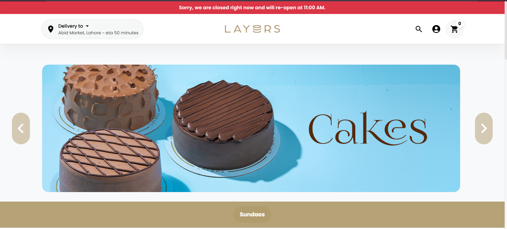

# Assignment 2 – COCO BAR

## Chosen Reference E-commerce Website

**Website Name:** LAYERS

**Website URL:** https://layers.pk/

### Why I Chose This Website

I chose Layers as my reference e-commerce website because of its modern and visually appealing design, simple navigation, and well-organized product displays. It provides a good example of how an online store presents products through attractive images, product names, prices, and individual product detail pages.

I also found its shopping experience useful for understanding how customers browse products, view product information, add items to their shopping cart, and proceed towards checkout.

I will use Layers as a design and functionality reference for my COCO BAR bakery and café website while developing my own layout, styling, and features using HTML, CSS, and Bootstrap.

### Homepage Screenshot

